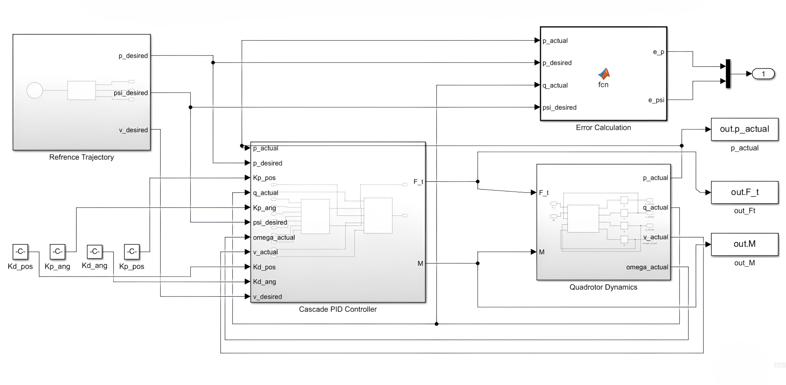
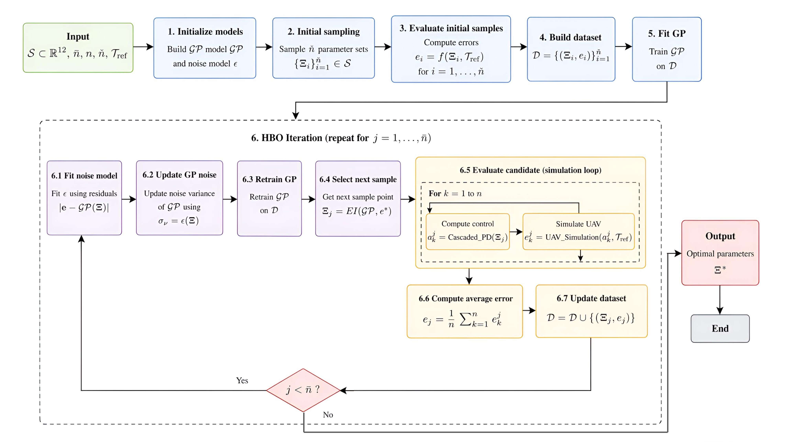
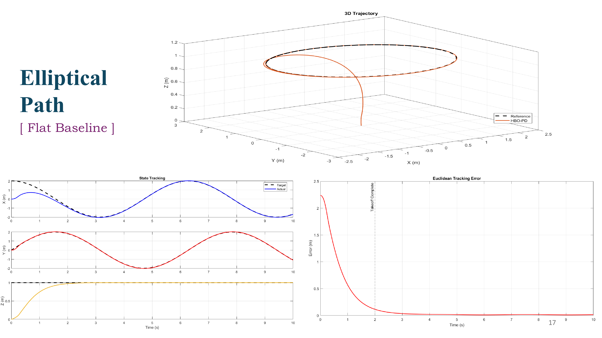
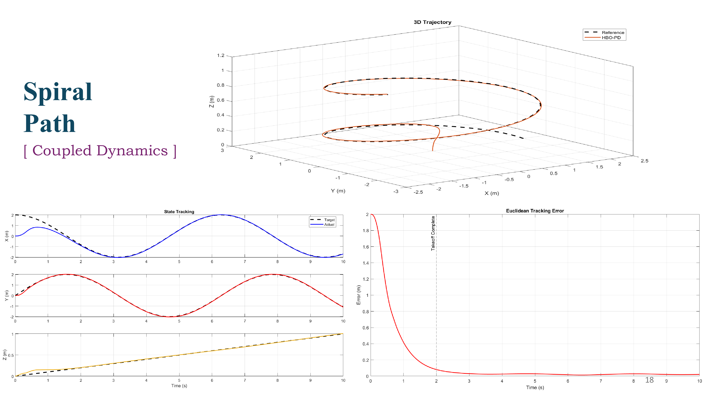
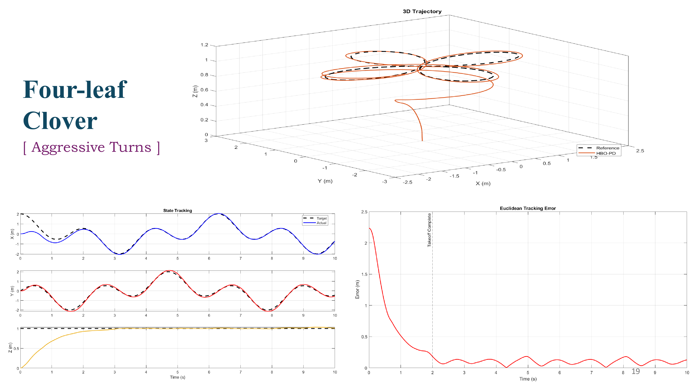
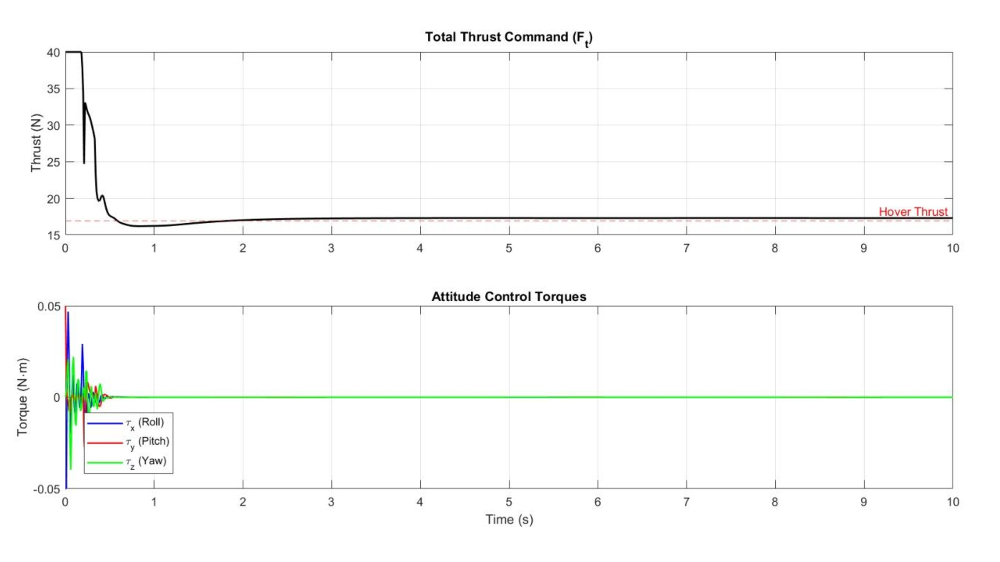
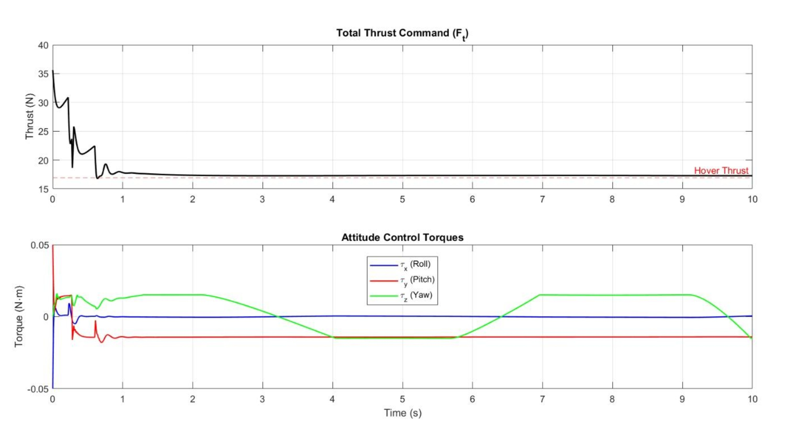
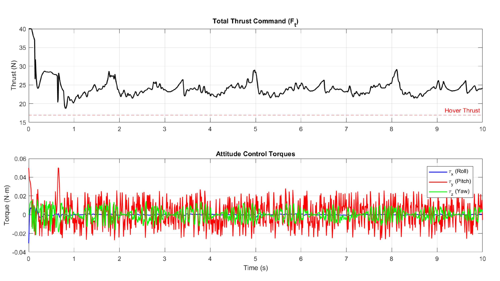

## Dynamic PD Tuning for Accurate and Robust UAV Trajectory Tracking using Heteroscedatic Bayesian Optimization

A MATLAB and Simulink framework using Heteroscedastic Bayesian Optimization (HBO) to dynamically tune a 12-parameter Cascaded PD controller. This architecture is designed to eliminate integral windup and actuator chatter, ensuring highly precise and robust 3D trajectory tracking for underactuated quadrotors.

## System Architecture As Seen In Simulink



## Optimisation Algorithm Block Diagram



## Visual Results

| Elliptical | Spiral | Four-leaf Clover |
| :---: | :---: | :---: |
|  |  |  |
|  |  |  |

## Prerequisites

Ensure the following software and toolboxes are installed on your system:
* MATLAB
* Simulink
* Statistics and Machine Learning Toolbox
* Optimization Toolbox

## Installation Instructions

Run the following commands in your terminal to clone the repository to your local machine:

```bash
git clone https://github.com/satwiksps/HBO-UAV-Trajectory-Control.git
cd HBO-UAV-Trajectory-Control
```

## Prerequisites

Ensure the following software and toolboxes are installed on your system:
* MATLAB
* Simulink
* Statistics and Machine Learning Toolbox
* Global Optimization Toolbox

## Run Instructions

1. Open MATLAB.

2. Navigate to the cloned repository folder within the MATLAB environment.

3. Launch the machine learning optimization sequence. This script will execute the Heteroscedastic Bayesian Optimization loop and load the optimal PD gains (`Kp_pos`, `Kd_pos`, `Kp_ang`, `Kd_ang`) into the base workspace:

```matlab
run('run_optimisation.m')
```

4. Once the optimization is complete, execute the results script. This will run the final closed-loop Simulink simulation using the optimized parameters, extract the kinematic data, print performance metrics to the console, and generate the 3D trajectory and control effort figures:

```matlab
run('plot_results.m')
```

5. To visually inspect the physical flight simulation architecture and the Cascaded PD controller blocks, open the provided Simulink model:

```matlab
open_system('unmanned_aerial_vehicle_model.slx')
```

