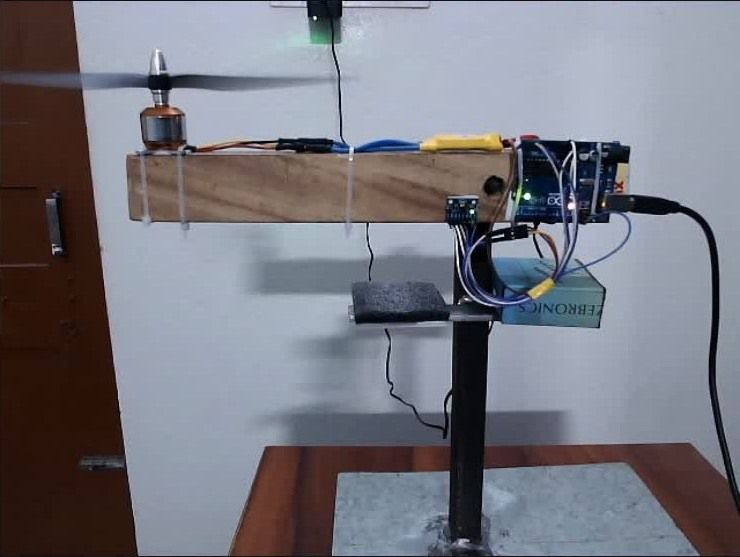
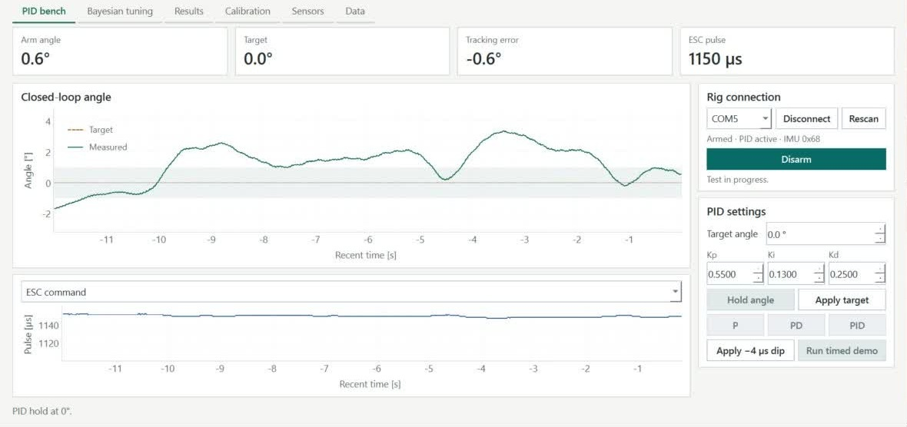

# HBO-Based PID Tuning for a UAV Propeller Arm

A single-axis propeller arm with an Arduino Uno, MPU6050 and a Python dashboard. The Uno closes the angle loop in real time. The dashboard runs experiments, records the response and uses heteroscedastic Bayesian optimisation (HBO) to choose PID gains to test on the bench.

<table>
  <tr>
    <td align="center"><a href="docs/images/propeller-arm.jpg"></a><br><strong>Propeller arm</strong></td>
    <td align="center"><a href="docs/images/dashboard.jpg"></a><br><strong>Dashboard during a hardware run</strong></td>
  </tr>
</table>

In five matched hardware runs at −9°, adding integral action reduced mean absolute hold error from **2.50° to 1.40°**. The tuning workflow proposes candidate gains and retests them against a manual baseline. [See the measurements and example data](docs/experiments.md).

## Try it

From the repository root, using Python 3.12 and PowerShell:

```powershell
cd hardware
py -3.12 -m venv .venv
.\.venv\Scripts\python.exe -m pip install -r requirements.txt
.\.venv\Scripts\python.exe dashboard.py --sim
```

Practice mode works without an Arduino. For the physical rig, follow the build and calibration guides before arming.

| Guide | Covers |
| --- | --- |
| [Hardware](docs/hardware.md) | Parts, mechanical assembly, wiring and bench checks |
| [Setup and calibration](docs/setup.md) | Firmware upload, three-pose calibration, first hold and troubleshooting |
| [Controller and optimiser](docs/control.md) | PID, tilt estimation, scoring, HBO and the USB protocol |
| [Experiments](docs/experiments.md) | Matched tests, results, example data and plot export |
| [MATLAB/Simulink model](docs/simulation.md) | Running the quadrotor simulation in this repository |

**Demo video:** Coming soon!
